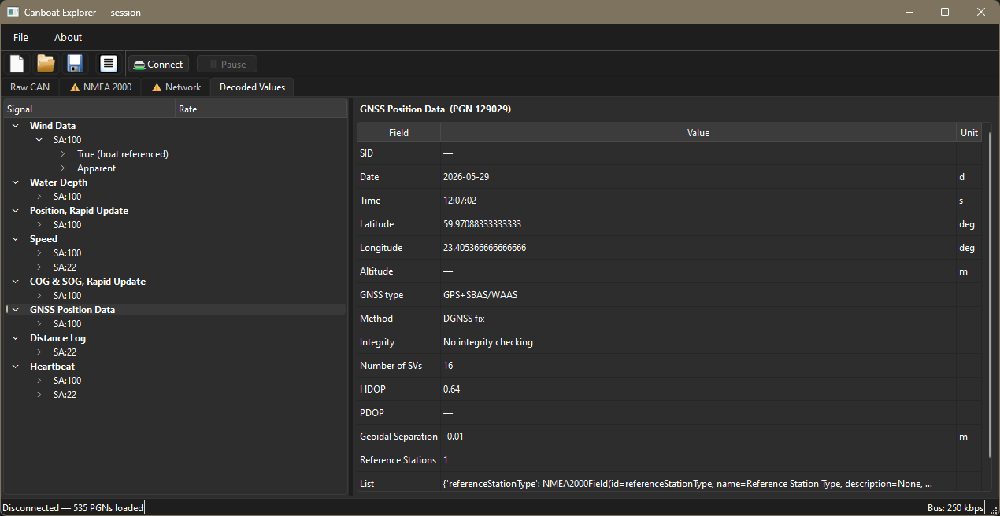
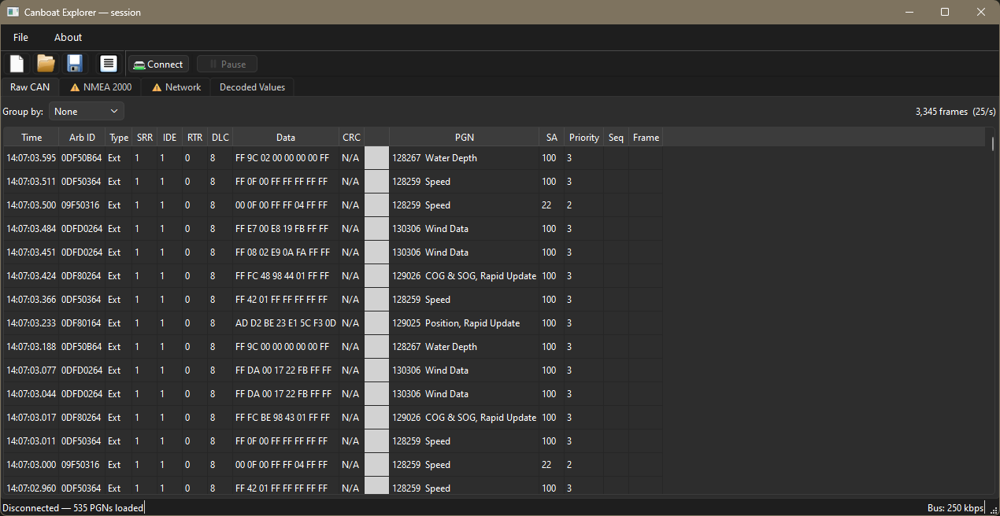
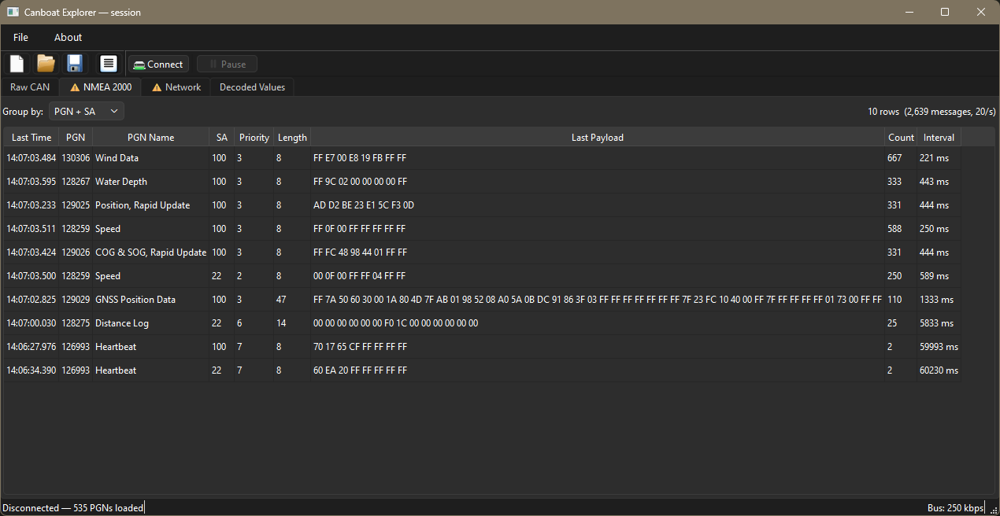
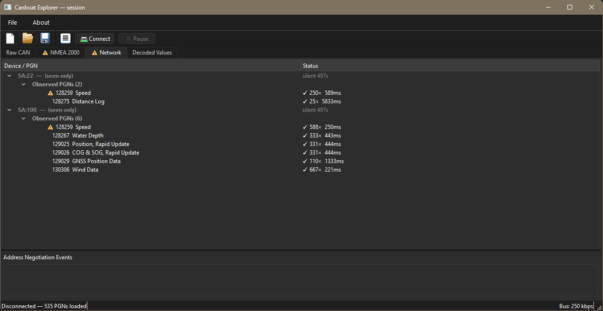
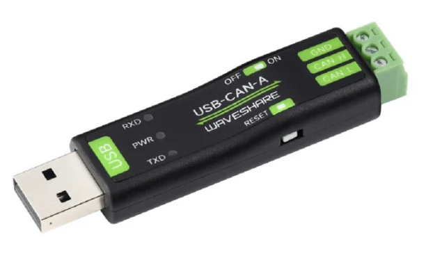
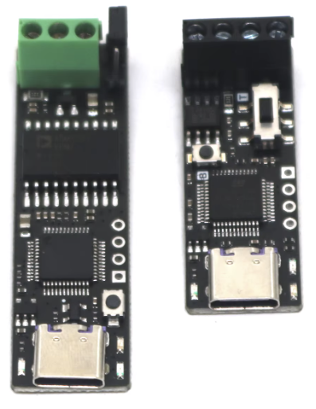
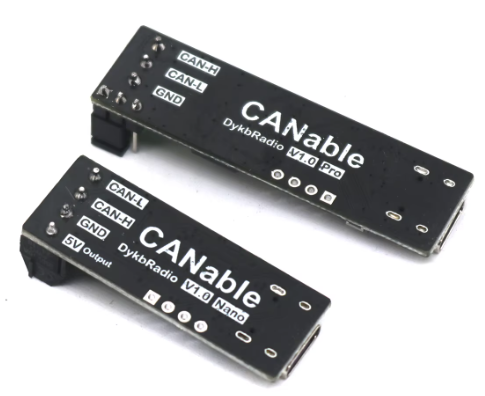

# Canboat Explorer

A desktop application for exploring, debugging, and recording CAN / NMEA 2000 bus traffic received via python-can. Currently only tested with the Waveshare USB-CAN-A (~25 usd) and cheap AliExpress PCAN clones (~8 usd) adapters.



## What it does

- **Verify** what a bus is and isn't transmitting
- **Discover** and reverse-engineer proprietary or obscure manufacturer messages
- **Record** traffic persistently across sessions, including through crashes

## Requirements

- Python 3.11+
- A supported CAN adapter: Waveshare USB-CAN-A, or maybe any adapter supported by python-can (`slcan`, `gs_usb`, `pcan`, `socketcan`)
- A live NMEA 2000 bus (default bitrate: 250 kbps)

## Installation
### Release
Just download the pre-build .exe file from the latest Release to the right. Settings and data/ files are stored next to the executable.

### From source
With uv:

```
uv pip install -e .
```

## Running

```
uv run canboat_explorer
```

Settings are written to `canboat_explorer.ini` at the project root on first run. Session logs are saved to `data/` next to the project root.

## Tabs

| Tab | Description |
|-----|-------------|
| **Raw CAN** | All incoming frames. Time view (newest first) or accumulated view grouped by Arb ID, PGN+SA, or PGN. |
| **NMEA 2000** | Assembled NMEA 2000 messages including fast-packet reassembly. Time and accumulated views. |
| **Network** | Device tree — one node per source address. Shows TX/RX PGN lists, observed traffic, collision markers, product info, and address negotiation events. Devices silent for >60 s are dimmed. |
| **Decoded Values** | Live signal values decoded via the `nmea2000` library. 3-level tree (PGN → SA → qualifier variant) with update rates and message history. |






## Session files

Frames are written to `data/session.canlog` on receipt, before any UI processing. The file survives crashes and is reopened automatically on the next start.

- **Save as** — export the current session to a named `.canlog` file
- **Open** — load a saved file for offline browsing
- **Clear** — discard the current session (requires confirmation)

## Supported adapters

Configure the interface type and port via **Settings** in the toolbar. The connection uses NMEA 2000's standard 250 kbps CAN bitrate.

### Waveshare USB-CAN-A



A cheap and widely available USB-to-CAN adapter based on a CH340 serial bridge. Enumerates as a virtual COM port on Windows and Linux.

- **USB ID:** `1A86:7523`
- **Driver:** CH340 (built into modern Windows; `ch341` on Linux)
- **Interface in Settings:** `waveshare`
- **Port:** pick the device's COM port (e.g. `COM5`) from the dropdown
- **Serial baudrate:** `2_000_000` (the adapter's default — do not confuse with the CAN bitrate)

No extra libraries required.

### PCAN / PCAN clone




Peak-System PCAN-USB and the many compatible clones. More robust than the Waveshare for high-traffic buses, but needs a vendor DLL on Windows.

- **USB ID:** `0C72:000C`
- **Interface in Settings:** `pcan`
- **Port:** select the PCAN channel from the dropdown (typically `PCAN_USBBUS1`)
- **Required library (Windows):** PCAN-Basic API DLL from Peak-System
  1. Download and unpack [PCAN-Basic](https://www.peak-system.com/products/software/development-packages/pcan-basic/)
  2. Copy `PCANBasic.dll` to `C:\Windows\System32`
     - Use `x86/PCANBasic.dll` for 32-bit Python
     - Use `x64/PCANBasic.dll` for 64-bit Python (most common)


## Credits

Canboat Explorer © Tijs van Roon — [github.com/knifter](https://github.com/knifter) — GPL-3.0

Built on parts from others:

- **The CANboat Project** PGN database © 2009-2025 Kees Verruijt — Apache 2.0 — [github.com/canboat](https://github.com/canboat)
- **nmea2000** © Tomer-w — Apache 2.0 — [github.com/tomer-w/nmea2000](https://github.com/tomer-w/nmea2000)
- **python-can** © python-can contributors — LGPL-3.0 — [github.com/hardbyte/python-can](https://github.com/hardbyte/python-can)
- **PyQt6** © Riverbank Computing — GPL-3.0
